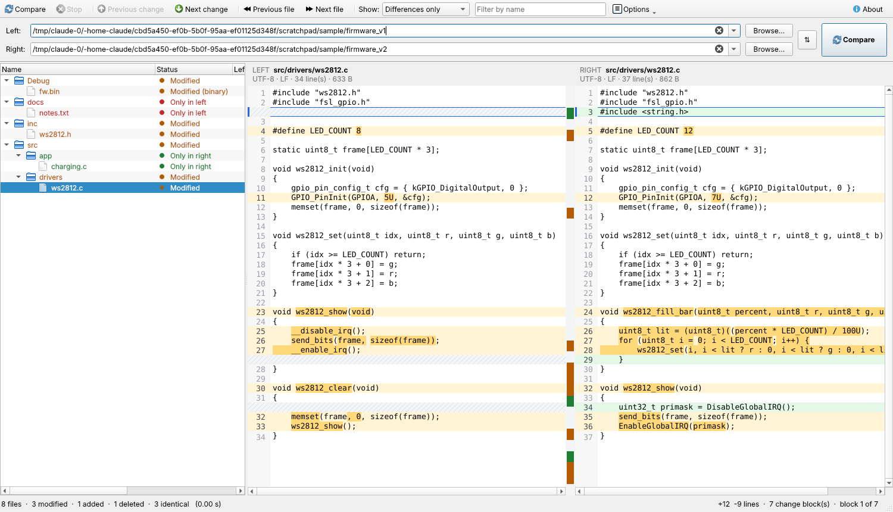

# CodeCompare

**Download:** get the latest `CodeCompare-vX.Y.Z-windows-x64.zip` from the [Releases](../../releases) page, unzip it and run `CodeCompare.exe`. No installation is needed.

An offline Windows desktop tool that compares two folders or workspaces and shows exactly what changed. It lists every file that was added, deleted or modified, then shows each changed file side by side, line by line, with the changed words highlighted inside each line.



Version 0.1 is view-only: it shows differences but does not copy or merge anything.

## Features

- **Recursive folder compare.** Every file in both folders is classified as one of:
  - Identical
  - Modified
  - Only in left (deleted)
  - Only in right (added)
  - File vs folder conflict
  - Error (could not be read)

  A folder's status rolls up from what it contains.
- **Exact results.** Files of equal size are compared byte by byte. There are no hash shortcuts and no sampling.
- **Line-by-line diff.**
  - **Algorithm:** uses the Myers algorithm, the same family as git. Results were cross-checked against `git diff --minimal` on thousands of files with identical counts.
  - **Highlighting:** shows which words changed inside each modified line.
  - **Alignment:** keeps similar lines on the same row.
  - **Readable blocks:** shifts change blocks so they read naturally. A new C function shows as one block, not split around a `}`.
- **Encodings without data loss.**
  - **Supported:** UTF-8, UTF-8 BOM, UTF-16 LE/BE and ANSI (Windows-1252).
  - **Binary files:** detected and never shown as garbled text. The byte offset of the first difference is shown instead.
- **Line endings.** CRLF and LF differences are shown, or can be ignored.
- **Ignore options:**
  - trailing whitespace
  - whitespace amount (like `git diff -b`)
  - all whitespace (like `git diff -w`)
  - letter case
  - line endings
- **Exclude patterns** work like `.gitignore`, for example `.git`, `build/`, `*.o`, `Debug/` or `docs/**/*.pdf`.
- **Fast.** A test on 22,000 files (381 MB) finished in about 1 second. All work runs in the background, so the window never freezes, and Stop cancels a running comparison.
- **Navigation:**
  - next and previous change in a file, and next and previous different file
  - an overview bar showing where all changes are in a file
  - filters such as "Differences only", plus a name search
- **Command-line tool** `codecompare-cli` for scripts and CI. It prints a list of changes, unified diffs (patch format) or a numstat summary.

## Keyboard shortcuts

| Key | Action |
| --- | --- |
| F5 | Compare |
| Esc | Stop a running comparison |
| F7 / Shift+F7 (or Alt+Down / Alt+Up) | Next / previous change |
| F8 / Shift+F8 | Next / previous different file |

You can also drag two folders from Explorer onto the window, or start it as `CodeCompare.exe <left folder> <right folder>`.

## Building on Windows

### Option A – on your PC (Qt + MinGW)

1. **Install Qt (one time).** Double-click **`setup_qt.bat`**. It installs Qt 6.8 (MinGW 64-bit), the MinGW compiler, CMake and Ninja into `C:\Qt` using the open-source *aqtinstall* tool, so you don't need a Qt account. The download is about 1 GB. It needs Python 3 for Windows on PATH.
   *Alternative:* use the official Qt Online Installer from <https://www.qt.io/download-qt-installer-oss>. That needs a free Qt account. Select **Qt 6.8 → MinGW 64-bit**, plus **MinGW 13.1**, **CMake** and **Ninja** under Developer and Designer Tools.
2. **Build.** Double-click **`build_windows.bat`**. It builds the app, runs the unit tests, creates **`dist\`** and opens that folder. If anything fails, the window stays open and shows the error.
3. **Run** `dist\CodeCompare.exe`. The `dist` folder is portable: you can copy it to any Windows PC and it runs without installing anything.

WSL is not used: WSL builds Linux programs, not Windows `.exe` files.

If Qt is installed somewhere other than `C:\Qt`, set the paths first:

```bat
set QT_DIR=D:\Qt\6.8.3\mingw_64
set MINGW_DIR=D:\Qt\Tools\mingw1310_64
build_windows.bat
```

**Using Qt Creator instead:** choose File → Open File or Project, then select `CMakeLists.txt`. Pick the *Desktop Qt 6.x MinGW 64-bit* kit and the **Release** configuration, then click Build.

### Option B – let GitHub build it

Every push to GitHub runs `.github/workflows/build-windows.yml`, which builds the app with MSVC and runs the tests. Download the **CodeCompare-windows** artifact from the run in the *Actions* tab. Pushing a version tag such as `v0.1.0` also publishes a downloadable zip on the Releases page. It contains the ready-to-run `.exe` and Qt DLLs, and you don't need to install anything on your PC.

## Command-line tool

```text
codecompare-cli [options] <left> <right>

  --diff                     unified diff for every modified text file
  --all                      also list identical files
  --numstat                  "added<TAB>removed<TAB>path" per changed file
  -w / -b / --ignore-trailing-space   whitespace options (as in git)
  --ignore-eol               ignore CRLF/LF differences
  -i                         ignore case
  --exclude ".git;build/;*.o"
Exit code: 0 identical, 1 differences, 2 error
```

## Project layout

```
src/core/     Engine in plain C++17 (no Qt): scan, match, compare, decode, diff
  FolderCompare  recursive scan, exclude rules, byte comparison, status roll-up
  TextDecode     binary/encoding detection, line splitting, ignore options
  Diff           Myers diff, block sliding, line alignment, word highlights
  IgnoreRules    .gitignore-style patterns
  Report         unified diff output, summaries
src/gui/      Qt 6 Widgets application (uses the engine)
  MainWindow     folder bar, toolbar, tree, background comparison
  FolderTreeModel  tree model with filtering
  DiffView / DiffPane / OverviewBar   side-by-side diff view
src/cli/      command-line tool
tests/        unit tests, git cross-check script, GUI screenshot tool
resources/    icon, Windows version info
```

The engine has no GUI dependency, so the desktop app, the command-line tool and the tests all use the same tested code.

## Testing

- `ctest --test-dir build` runs about 12,000 checks:
  - patterns, decoding and whitespace options
  - folder comparison, unified diff output and cancellation
  - 4,000 randomized diff cases verified against a brute-force LCS for minimality
- `python tests/compare_with_git.py build/codecompare-cli 1000` builds random folder pairs (CRLF/LF, missing final newlines, binaries, nested folders) and checks that every per-file line count matches `git diff --no-index --minimal --numstat`. This needs git and Python.

## Roadmap

- Copy or merge changes between left and right
- Export an HTML report
- Three-way compare
- Rename/move detection
- Explorer right-click integration
- Installer
- Long-path (>260 chars) manifest
- Syntax highlighting
- Patience/histogram diff option

## License

MIT. See [LICENSE](LICENSE). You are free to use, modify and share it.
